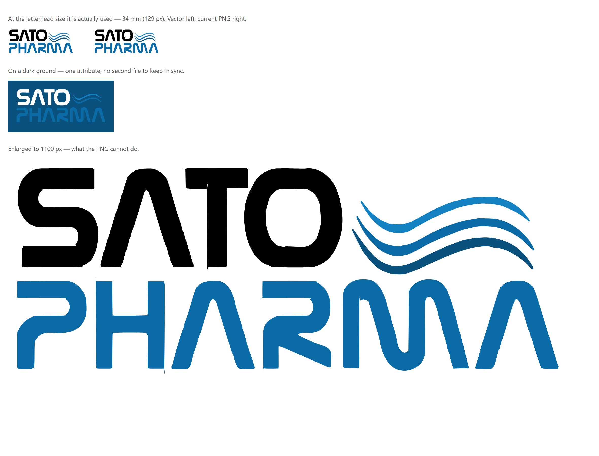

# The house document identity — SATO-DIS-2026-01

The account behind the hook in [AGENTS.md](../AGENTS.md) §4. Approved by the owner on 2026-09-05.
The specimen he approved is `xlsx/Sato-Pharma-Document-Identity-Standard.pdf` (10 pages, A4); the
four drafts that led to it sit beside it and are worth keeping, because each one records a decision.

## What it is

One letterhead, one palette and one page geometry for every document the company issues — the hiring
pack, the leavers pack, offer letters, and any letter or certificate on company paper. It is the
**company's** identity, Sato Pharma, and explicitly not the Phoenix application's; the owner
corrected that in the first exchange.

`src/lib/hiring-pack/house-identity.ts` is the only definition. Before it, four renderers each held
a private copy of a navy masthead and had already drifted — 16 pt in one file and 15 pt in another,
a 30 mm mark here and 32 mm there — while the job-offer letters ran on a different blue entirely.

## The palette is measured, not chosen

Every value was sampled pixel-by-pixel from the company mark:

| Role | Hex | Source in the artwork |
| --- | --- | --- |
| Ink | `#000000` | the SATO wordmark |
| Brand Deep | `#0A527D` | the wave's darkest stroke |
| Brand Blue | `#0A6BA6` | the PHARMA wordmark |
| Brand Light | `#1482C2` | the wave's lightest stroke |
| Zebra tint | `#F2F6FA` | Brand Blue at 6% on white |

This replaced a navy `#0B2A4A` that appears in no part of the logo — it came from the old Word
originals. The owner did not engage with the "Deep or navy" question when it was put to him in those
words; he answered by approving the sheet, so it is settled and should not be re-asked.

## The ink rule

His instruction, and the constraint every other decision answers to: **no filled areas, anywhere.**
These print in volume on office machines — a contract in three copies, a clearance in two, a custody
receipt for every device issued — so colour is carried by lines and type and never by area.

Measured on the rendered pages of the specimen: **9.97% → 3.18%** page coverage, a ~69% toner
saving. The filled masthead band became the mark plus one 0.7 mm rule; filled table headers became
bold type over a rule; tinted panels became a rule on the leading edge.

The one exception is the zebra row, which he asked for by name ("ZEBRA TABLED") after seeing the
version without it. It is set at 6% and **replaces** the row hairline rather than joining it, so it
costs 0.15 of a point of coverage.

## What it must never touch

Social-insurance Form 1, Form 6 and the labour exit form are facsimiles of what the Authority
issues. They print exactly as the Authority lays them out — no letterhead, no palette, no house
geometry. `render-form1.ts`, `render-form6.ts` and `render-labour-exit.ts` must not import
`house-identity.ts`. Restyling one makes it a form the insurance office can refuse.

## Two traps this exists to stop

**The white-wordmark logo on white paper.** `sato-pharma-logo.png` sets "SATO" in white for dark
grounds. The house format has no dark grounds, so on paper the answer is always
`sato-pharma-logo-on-light.png` — otherwise half the mark disappears and the letterhead reads
"PHARMA". That had already reached printed output.

**Latin text inside an RTL letterhead.** "Sato Pharma L.L.C." rendered as ".Sato Pharma L.L.C" —
the trailing full stop is a neutral character and the bidirectional algorithm resolved it to the
paragraph direction. `dir="ltr"` on the element holding only Latin is the fix; `dir="auto"` on the
block is not, because it reads the first strong character and would reverse the Arabic name instead.
Measured in a browser by comparing glyph x-positions, which is the only way to settle it — reading
Arabic direction off a screenshot produced the wrong answer twice.

## The vector mark, and what is still outstanding

**A vector mark now ships, and it is what documents use.** The raster was 401 × 158 px — exactly
300 dpi at the 34 mm letterhead size, with no headroom — so it was upsampled on every document
printed at 600 dpi and could not be enlarged for a certificate or a sign. `HOUSE_MARK_SRC` in
`house-identity.ts` points at `/brand/sato-pharma-logo-on-light.svg`, and the dark-ground variant is
one fill attribute away rather than a second file to keep in sync.

The comparison above is the evidence the switch was made on: indistinguishable at the 34 mm size
they are actually used at, and only the vector holds above it.

**What is still outstanding is the designer's original.** The `.svg` was TRACED from the raster and
is bounded by what that raster knows, so it is not a substitute for the original `.ai`/`.eps` if one
ever turns up — `house-identity.ts` says so at the constant itself. And the XLSX path is still
raster (`HOUSE_MARK_XLSX_PATH` → `sato-pharma-logo-on-light.png`), because ExcelJS accepts png/jpeg/gif
only and hands anything else to a part Excel then silently repairs. Neither costs ink; both are
quality ceilings rather than defects.

## How the specimen is built

HTML printed by Chrome, matching how these documents already work — `render-shared.ts` explains why a
PDF library cannot set Arabic. Logos are inlined as base64, `chrome --headless=new --print-to-pdf`
renders it, and `pdf-lib` stamps the metadata afterwards. Page numbers, section numbers and the
contents list are generated at load rather than typed; they had already drifted out of sequence once
when a page was inserted.
