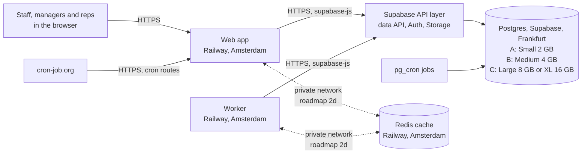

# Phoenix — recommended architecture

> **Corrected on 28 Oct 2026 by the [final validation](PHOENIX-FINAL-INFRASTRUCTURE-DECISION-VALIDATION.md)**, which decides to keep Small and optimise (Decision A). Where this report and the validation differ, the validation is right.

Three architectures that keep Supabase as the one authoritative database, with no migration. Prices are official list
prices read on 28 Oct 2026; the arithmetic is in the [cost and performance document](PHOENIX-MAXIMUM-PERFORMANCE-MINIMUM-COST.md).

**The finding all three rest on:** the database server is short of memory (4.3 GB of data on a 2 GB machine, about 7 GB
swapped out in 55 hours). Its CPU and disk have room, and the app servers on Railway use a fifth of one core at peak.
Evidence: the [baseline](PHOENIX-INFRASTRUCTURE-BASELINE-AUDIT.md) and the [PostgreSQL audit](PHOENIX-SUPABASE-POSTGRES-PERFORMANCE-AUDIT.md).

## A — lowest cost: stay on Small, take load off

| | |
| --- | --- |
| Database | Supabase Small, unchanged (2 GB) |
| App | Railway, unchanged |
| Changes | Stage 2 of the [roadmap](PHOENIX-INFRASTRUCTURE-IMPLEMENTATION-ROADMAP.md): lighter CRM view reads, the import-row search, touch-trail retention, a cache that survives deploys, fewer polling requests |
| Extra cost | **$0**, or a few dollars a month for the cache service |

**What it buys:** less work per page. **What it cannot buy:** memory. Postgres's 512 MB of shared buffers and the platform
services beside it already fill most of the 2 GB, and no code change shrinks the services' share. The database also keeps
growing. Since the 25 Oct fixes there has been no restart, but the box still swapped about 6.6 GB in two working days and
stalled for 15 seconds on 27 Oct. **This is the most likely to fail again in an afternoon.**

## B — best value for money (recommended): Medium, plus the same load cuts

| | |
| --- | --- |
| Database | **Supabase Medium: 4 GB RAM**, shared CPU. Production only. |
| App | Railway, unchanged |
| Cache | Next.js data cache in a small Redis service **inside the same Railway project and region**, on the private network |
| Changes | All of Stage 2, one pull request at a time |
| Extra cost | **+$45 a month** for Medium, plus the cache service at Railway's usage rates |

**Why this one.** It is the smallest step that addresses the cause that has been measured. Twice the memory lets shared
buffers and the platform services fit with room for the operating system's file cache, which is what stops the swapping
(forecast, to be checked against the Stage 1 acceptance numbers). The load cuts then keep the database from growing back
into the limit. Supabase bills compute by the hour, so if the numbers say it did not help, going back to Small costs one
restart and about $1.50 a day for the days it ran.

**What it does not buy:** dedicated CPU. Medium still runs on shared CPU. The CPU has shown no sign of being held back
(steal 0.55 %), so paying for dedicated cores now would pay for a problem that has not been seen.

## C — maximum performance without moving the database: Large or XL

| | |
| --- | --- |
| Database | Supabase **Large** (8 GB, 2 dedicated cores, +$95) or **XL** (16 GB, 4 dedicated cores, +$195) |
| App, cache, changes | As in B |
| Extra cost | **+$95 to +$195 a month** |

At 16 GB the whole 4.3 GB database sits in memory more than three times over, and the cores are not shared. It would be
the fastest Phoenix can run without moving the database. **There is no evidence yet that it needs this.** It is the answer
only if Medium's numbers show steal or swapping that Medium cannot absorb ([roadmap, Stage 3](PHOENIX-INFRASTRUCTURE-IMPLEMENTATION-ROADMAP.md#stage-3--only-if-the-evidence-asks-for-it)).

## Side by side

| | A — lowest cost | **B — recommended** | C — maximum |
| --- | --- | --- | --- |
| Database memory | 2 GB | **4 GB** | 8–16 GB |
| Dedicated CPU | no | no | yes |
| Extra a month | $0 | **+$45** | +$95 to +$195 |
| Addresses the measured cause | partly | **yes** | yes, with headroom |
| Risk of afternoon stalls | highest | **low (forecast)** | lowest |
| Reversible | — | **yes, by the hour** | yes, by the hour |
| New data processor | no | **no** | no |

## The components, and how data moves

The three architectures share one shape; only the database size differs, and the cache is optional in A.

A request reaches the web app, which checks the caller's access on the server, then either answers from the cache (a key
that carries the caller's access scope) or reads through the Supabase API layer and stores the answer under that key. Writes
always go to the database and clear the matching cache tags, for the web app and the worker together.

## Each architecture in detail

| | A — lowest cost | **B — recommended** | C — maximum |
| --- | --- | --- | --- |
| **Specifications** | Supabase Small: 2 GB, shared CPU. Railway unchanged. Optional Redis capped at about 0.25 GB. | Supabase Medium: 4 GB, shared CPU. Railway unchanged. Redis capped at about 0.25 GB. | Supabase Large (8 GB, 2 dedicated cores) or XL (16 GB, 4 dedicated cores). The rest as B. |
| **Data flow** | As the diagram | As the diagram | As the diagram |
| **Deployment** | Stage 2 pull requests through the normal pipeline and release gate; the Redis service added from Railway's template in the production project | One size change on the Supabase screen, then the same pull requests | As B, a larger size |
| **Networking** | Unchanged: HTTPS from Railway to Supabase. Redis on Railway's private network, no public address. | Same | Same |
| **Security** | Service-role key on the server only; every cache key carries the caller's access scope; no new data processor | Same | Same |
| **Cost a month** | ≈ $90–93 | **≈ $136–138** | ≈ $186–188 (Large) or ≈ $286–288 (XL) |
| **Bottleneck afterwards** | Database memory, unchanged | Shared CPU first, then memory again if the data the working day touches outgrows 4 GB | None expected at today's load; the API layer's cost per request |
| **Gains (forecast)** | Fewer pages touched and fewer requests; the swapping continues | Swapping stops or falls sharply; the stalls go with it | All data in memory; cores not shared |
| **Failure modes** | Afternoon swap stalls and restarts, as before 25 Oct | The resize restart; steal on shared CPU; growth refilling the memory | As B, at a higher bill |
| **Complexity** | Medium: code changes | Medium: the same code changes, plus one click | As B |
| **Effort** | Four or five pull requests over a few weeks | One click, then the same pull requests | As B |
| **Rollback** | Each pull request reverts on its own; without Redis the cache falls back to the container's disk, as today | The same screen, back to Small: one restart, billing stops within the hour | The same screen, one size down |

## Rules every architecture keeps

- **Supabase stays the authoritative database.** Nothing is migrated or copied to another provider.
- **The service-role key stays on the server.** Browsers never receive it; a cache is read only by server code.
- **A cached answer never bypasses an access check.** Each cache key carries the caller's access scope, as the
  [26 Oct cache audit](../production-audits/cache-audit-2026-10-26.md) requires; anything personal stays out of shared keys.
- **No employee data goes to a new third party.** The cache stays inside the Railway project that already runs the app.
- **The compute size is the owner's decision on the Supabase screen**, never a script or a chat word.

## What was considered and not recommended

| Option | Why not |
| --- | --- |
| A bigger external server (8, 16 or 32 GB) beside Supabase | It cannot add memory to the Supabase server. The app tier it could run is already nearly idle. Detail in the [options document](PHOENIX-EXTERNAL-COMPUTE-OPTIONS.md). |
| A self-managed read copy of the database on another provider | Puts employee records with a new provider, needs replication that can fill the production disk if the copy stops, and is too much machinery for one owner. |
| A Supabase read replica now | A replica inherits the primary's size, so it is a second 2 GB machine with the same memory limit. Supabase's API load balancer can send GET requests to a replica; Auth, Storage and Realtime stay on the primary, and supabase-js sends a function call (`.rpc`) as a POST by default, so the heaviest functions would stay on the primary without a code change. A replica also lags the primary, so a screen can read just before its own save lands: the "your save does not show" class of bug the cache audit closed. Every read-after-save path would need review. The primary keeps its own 2 GB problem for every write and every function call. Medium needs no code change. |
| Moving the background worker or jobs elsewhere | The heavy work is SQL that runs inside the database wherever the caller sits. |
| Proxying the site through Cloudflare | Pages are dynamic and personal; only static files would cache. A small saving in egress, plus a new cache to keep from serving one person's page to another. |
| More disk IOPS | The disk is 1.4 % utilised. |
