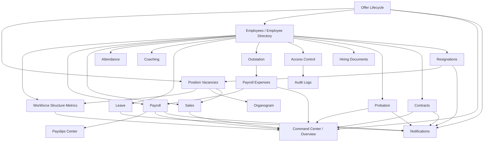

# Phoenix Workforce System Workflow And Logic Linkage Audit

Date: 2026-05-18

## Purpose

This document maps the sidebar modules to their current workflow, service layer, API layer, cross-module dependencies, and business-logic ownership.

The target is simple: a business rule should be defined once in a canonical domain service, then reused by pages, APIs, reports, dashboards, and portals. UI components should render typed data; they should not own business calculations.

## Current Architecture Summary

Phoenix Workforce already has a useful domain-service shape:

- Pages live in `app/**/page.tsx`.
- API mutations and exports live in `app/api/**/route.ts`.
- Business logic mostly lives in `src/lib/**`.
- Shared permission logic lives in `src/lib/auth/permissions.ts`.
- Audit and notifications are shared through `src/lib/admin/audit.ts`, `src/lib/notifications/email.ts`, and `src/lib/notifications/in-app.ts`.
- Supabase/Postgres is the database source of record.

The main issue is not that there are no services. The issue is that some executive and portal surfaces still recompute cross-domain metrics locally instead of consuming canonical metrics.

## System-Wide Logic Standard

Every business rule should follow this path:

1. Canonical domain service owns the rule.
2. API routes call domain services for mutations.
3. Dashboard aggregators combine domain outputs without inventing new rules.
4. Components display already-computed DTOs.
5. Tests prove critical rules and workflow transitions.

Forbidden pattern:

```ts
const totalStructure = employees.length + vacancies.length;
```

Required pattern:

```ts
const { totalStructure } = await getWorkforceStructureSummary();
```

## Current Cross-Module Dependency Map



## Sidebar Module Audit

| Sidebar module | Route | Current source of truth | Workflow summary | Linked modules | Current linkage status |
|---|---|---|---|---|---|
| Command Center | `/admin` | `src/lib/admin/command-center.ts` | Aggregates HR, payroll, sales, expenses, recruitment, contract, and probation signals. | Employees, payroll, sales, expenses, offers, contracts, probation, data health | Partial. It aggregates correctly now for workforce structure, but still contains local sales, expense, recruitment, and risk calculations that should move to canonical metric services. |
| System Audit | `/admin/system-audit` | `src/lib/system-audit/` (ledger), `src/lib/security/login-security.ts`, `src/lib/admin/service.ts#getSalaryFlags` | Replaced Data Health and Monitoring (and System Issues) on 2026-10-23: folded errors and integrity findings, the nightly integrity checks, login security, salary flags and role coverage. Super Admin only. | Access, auth, payroll, sales, audit logs, notifications | One page for every system error and silent data inconsistency; a source it cannot read is shown as unavailable, never as zero. |
| Audit Logs | `/admin/logs` | `src/lib/admin/audit.ts` | Reads and writes audit log records. | Auth, access, salary flags, workflows | Good shared utility. Gaps remain where some workflow mutations write domain audit tables but not global audit logs. |
| Employees | `/employees` | `src/lib/employees/employee-directory.ts` | Loads active employee directory, lookups, imports, manual create/update, resignation launch. | Access, payroll, sales, coaching, attendance, outstation, leave, lifecycle | Central but overloaded. It is the root dependency for most modules. Workforce metrics should be extracted from this and vacancy data into a dedicated workforce metrics service. |
| Organogram | `/organogram` | `src/lib/reports/vacancies.ts#getVacancyReport` | Shows active employees and vacancies in hierarchy/report view. | Employees, vacancies, workforce classification | Good linkage, but it shares vacancy report service rather than a dedicated organogram/workforce structure service. |
| Vacancies Report | `/reports/vacancies` | `src/lib/reports/vacancies.ts#getVacancyReport` | Lists open positions by area, line, manager, and status. | Employees, vacancies, organogram, offers, resignations, sales | Good domain grouping. Should consume canonical workforce vacancy rules once created. |
| CV Database | `/cv-database` | `src/components/cv/cv-database-manager.tsx`, `/api/cv-database/template` | Template/download surface for candidate/CV data. | Vacancies, offers | Weak service boundary. It is UI/API oriented; candidate pipeline rules are not clearly centralized. |
| Offer Lifecycle | `/offers` | `src/lib/offers/service.ts` | Create offer, send/accept/reject public token, approve accepted offer, close matching vacancy, create employee. | Vacancies, employees, notifications, payroll compensation | Strong workflow service, but transactionality depends on DB/RPC readiness and should remain guarded by tests. |
| Hiring Documents | `/hiring-documents` | `src/lib/hiring-documents/service.ts` | Tracks required hiring documents per employee, definitions, statuses, and HR notes. | Employees, access | Good isolated service. Should link more explicitly to offer approval/new employee onboarding. |
| Probation | `/probation` | `src/lib/probation/service.ts` | Loads probation rows, evaluations, reminders, workflow transitions, employee status changes. | Employees, notifications, exports | Good service ownership. Needs canonical lifecycle status integration so termination/pass/extend effects are reusable outside this page. |
| Contract Renewal | `/contracts` | `src/lib/contracts/service.ts` | Creates and reviews contract renewal requests, workflow actions, reminders. | Employees, notifications, command center risk | Good service ownership. Command center risk currently recalculates date-window logic and should consume a contract metrics function. |
| Resignations | `/resignations` | `src/lib/resignations/service.ts` | Creates resignation, runs workflow, opens vacancy, deactivates employee/runtime access. | Employees, vacancies, access, notifications, payroll candidates | Strong workflow service. It is one of the most important cross-module flows and should be covered by integration tests around vacancy and access effects. |
| Fingerprint Report | `/attendance/fingerprint-report` | `src/lib/attendance/fingerprint-report.ts` | Combines raw punches, employee directory, departments, and attendance policies into report rows. | Employees, attendance policies, device mapping | Good module service. It depends on employee identity and policy rules. |
| Device User Mapping | `/attendance/device-user-mapping` | `src/lib/attendance/device-user-mapping.ts` | Maps biometric device users to employee HR IDs, includes template/import support. | Employees, raw punches, attendance report | Good isolated service. |
| Attendance Policies | `/attendance/policies` | `src/lib/attendance/policies.ts` | Maintains attendance rule groups and target-specific rules. | Employees, fingerprint report | Good isolated service. |
| HR Calendar | `/hr-calendar` | `app/hr-calendar/page.tsx`, `src/components/hr-calendar/hr-calendar.tsx` | Renders calendar based on employee directory dates/events. | Employees, contracts/probation dates indirectly | Weak service boundary. Page currently loads employee rows directly; calendar event rules should move to `src/lib/hr-calendar/service.ts`. |
| Monthly Sales | `/sales/import?tab=approvals` | `src/lib/sales/service.ts`, `src/lib/sales/import-workflow.ts` | Upload, validate, review, approve/reject/replace/delete sales import batches. | Employees, vacancies, sales ownership classification, audit | Strong service ownership. |
| Sales Dashboard | `/sales` | `src/lib/sales/service.ts#getSalesDashboard`, `src/components/sales/*` | Shows approved sales, targets, product/line/manager/rep analytics. | Employees, vacancies, sales imports | Partial. The service returns data, but some KPI/chart calculations still happen inside components. Move reusable sales metrics to service DTOs. |
| Field Coaching | `/coaching` | `src/lib/coaching/service.ts` | Lists coaching reports, creates/submits/reviews/acknowledges reports. | Employees, sales roles, notifications | Good service ownership. |
| Coaching Analytics | `/coaching/analytics` | `src/lib/coaching/service.ts`, `src/lib/coaching/analytics.ts` | Aggregates score analytics for reports. | Employees, coaching reports | Good logic split between service and analytics helper. |
| Payroll Report | `/payroll` | `src/lib/payroll/service.ts` | Upload/validate salary sheets, create/replace batches, review flags, run workflow, export/download. | Employees, expenses, resignations, notifications | Strong service ownership. Need extract reusable payroll metrics for command center/overview. |
| Payslips Center | `/admin/payslips-center` | `src/lib/payroll/payslip-center.ts` | Searches salary records by employee and displays/downloads payslip-centered data. | Payroll, employees, access scope | Good isolated service. |
| Expenses | `/payroll/expenses` | `src/lib/payroll/service.ts`, `src/lib/payroll/expenses.ts` | Reviews expense reports and payroll-importable expenses. | Payroll, employees, outstation | Partial. Page uses payroll dashboard while expense logic also lives in expense service. Should have a single expense dashboard DTO. |
| Expenses Dashboard | `/payroll/expenses/dashboard` | Page loads `getEmployeeDirectory`; component computes dashboard | Shows expense aggregates and workload. | Employees, expenses, outstation | Weak source-of-truth. More expense aggregation should move from component/page into `src/lib/payroll/expenses.ts`. |
| Outstation Requests | `/admin/outstation/requests` | `src/lib/outstation/service.ts` | Admin reviews submitted outstation requests and car evidence. | Employees, residence location, Google routes, expenses | Strong workflow service. |
| Outstation Policy | `/admin/outstation/policy` | `src/lib/outstation/service.ts` | Edits allowance/rule policy. | Outstation calculation, expenses | Strong service ownership. |
| Outstation Heatmaps | `/admin/outstation/heatmaps` | `src/lib/outstation/service.ts#getOutstationHeatmapData` | Aggregates outstation requests geographically. | Outstation requests, employees | Good service ownership. |
| Vacation Request | `/leave-management/vacation-request` | `src/lib/vacation/service.ts`, `src/lib/vacation/calculations.ts` | Creates leave request, calculates balance/payment status, notifies manager. | Employees, notifications | Good service ownership. |
| Vacation Report | `/leave-management/vacation-report` | `src/lib/vacation/service.ts#getVacationReportData` | Lists and filters leave requests with balances/status. | Employees, leave requests | Good service ownership. |
| Users & Access | `/admin/access` | `src/lib/admin/access-control.ts`, `src/lib/auth/permissions.ts` | Manages app users, access profiles, permission overrides, status, password setup. | Employees, auth, audit | Strong but high impact. It is a cross-cutting source of truth for authorization. |
| Email Composer | `/admin/email-reply-composer` | `app/api/admin/email-reply/send/route.ts`, `src/lib/email/*` | Sends composed HR/admin email replies. | Email templates, notifications | Partial. It is route-centric; reusable email composition rules should be clearer. |
| Email Templates | `/admin/email-templates` | `src/lib/email-templates/service.ts` | Manages template defaults, placeholders, recipient routing rules. | Notifications, roles, employees | Good service ownership. |

## Critical Business Logic Ownership

| Business rule / metric | Current owner | Current problem | Target owner |
|---|---|---|---|
| Active employee definition | `src/lib/employees/employee-directory.ts`, `src/lib/workforce-classification.ts` | Used broadly, but summary naming says `totalEmployees` while returning active directory count. | `src/lib/workforce/workforce-metrics.ts` plus existing classifier. |
| Total structure = active employees + open vacancies | `getDataHealthStats`, `getVacancyReport`, recent command center wiring | Not yet available as a clean reusable function. | `getWorkforceStructureSummary()`. |
| Open vacancy definition | `src/lib/reports/vacancies.ts`, `src/lib/offers/service.ts`, `src/lib/admin/service.ts` | Several readers query `position_vacancies` separately. | `src/lib/workforce/vacancy-metrics.ts` or workforce metrics service. |
| Payroll totals | `src/lib/payroll/service.ts#getPayrollDashboard` | Command center and overview should consume payroll metrics, not query salary tables directly. | `src/lib/payroll/payroll-metrics.ts` wrapping existing payroll dashboard logic. |
| Sales achievement | `src/lib/sales/service.ts`, components in `src/components/sales/*`, command center local query | Same formula appears in service, command center, and UI. | `src/lib/sales/sales-metrics.ts`. |
| Expense totals | `src/lib/payroll/expenses.ts`, command center local query, expense dashboard component | Aggregation is split. | `src/lib/payroll/expense-metrics.ts`. |
| Offer acceptance/pipeline | `src/lib/offers/service.ts`, command center local query | Offer dashboard has this summary, command center duplicates it. | `getOfferDashboard()` or `src/lib/offers/offer-metrics.ts`. |
| Contract risk window | `src/lib/contracts/service.ts`, command center local filter | Command center applies its own 30-day logic. | `src/lib/contracts/contract-metrics.ts`. |
| Probation risk window | `src/lib/probation/service.ts`, command center local employee date filter | Command center calculates from hire date, not probation service. | `src/lib/probation/probation-metrics.ts`. |
| Audit logging | `src/lib/admin/audit.ts`, domain-specific audit tables | Some modules use global audit, some use domain audit only. | Keep domain audit, add standard audit contract for high-risk mutations. |
| Notifications | `src/lib/notifications/email.ts`, `src/lib/notifications/in-app.ts` | Good shared services, but some delivery failures are intentionally non-blocking. | Keep shared service; add workflow-level delivery status where needed. |

## Main Consolidation Risks Found

1. `src/lib/admin/command-center.ts` is an aggregator but still owns local business calculations for sales, expenses, recruitment, contract risk, and probation risk.
2. `src/lib/overview/service.ts` is another aggregator and repeats many of the same cross-domain calculations.
3. `src/components/sales/sales-dashboard.tsx` and `src/components/sales/sales-performance-page.tsx` compute reusable KPI/chart logic in the UI.
4. `/payroll/expenses/dashboard` loads employee directory directly and leaves dashboard aggregation mostly outside a canonical expense service.
5. HR Calendar lacks a clear service layer for calendar event rules.
6. CV Database is attached to vacancy permission but lacks an obvious canonical candidate/CV domain service.
7. Employee directory is a root dependency for almost everything, so naming and summary semantics must be precise. `totalEmployees` currently means active employee directory count in several places, not all employee records.
8. Employee portal service is very large and reuses many domain rules, but some portal-specific fallbacks can drift from admin-side calculations.

## Recommended Source-Of-Truth Services

Create only the services that remove real duplication:

```txt
src/lib/workforce/workforce-metrics.ts
src/lib/sales/sales-metrics.ts
src/lib/payroll/payroll-metrics.ts
src/lib/payroll/expense-metrics.ts
src/lib/offers/offer-metrics.ts
src/lib/contracts/contract-metrics.ts
src/lib/probation/probation-metrics.ts
src/lib/hr-calendar/service.ts
src/lib/platform/platform-metrics.ts
```

`platform-metrics.ts` should not invent formulas. It should only combine canonical domain metrics for command center and overview.

## Migration Phases

### Phase 1 - Workforce Source Of Truth

Goal: stop employee/vacancy/structure drift everywhere.

1. Add `getWorkforceStructureSummary()`.
2. Return active employees, open vacancies, total structure, missing managers, unique lines, unique areas.
3. Rewire command center, data health, overview, organogram, vacancy report, employee portal org summaries.
4. Add tests for active + vacancies = total structure.

### Phase 2 - Platform Metrics Aggregator

Goal: command center and overview consume the same DTOs.

1. Add `getPlatformMetrics(accessContext)`.
2. Move command center local sales/expense/recruitment/risk queries into domain metrics.
3. Make `/admin` and `/overview` consume platform metrics.
4. Add tests for aggregator fallback behavior.

### Phase 3 - Sales And Expense Metrics

Goal: remove KPI math from components.

1. Move reusable sales KPIs and chart summaries from components to `sales-metrics.ts`.
2. Move expense dashboard summaries to `expense-metrics.ts`.
3. Keep UI filtering state in components only.

### Phase 4 - Lifecycle Metrics

Goal: make offer, contract, probation, resignation effects visible consistently.

1. Add offer, contract, and probation metric functions.
2. Ensure resignation-created vacancies and offer-closed vacancies feed workforce structure immediately.
3. Add regression tests around lifecycle-to-workforce linkage.

### Phase 5 - Remaining Weak Boundaries

Goal: close sidebar modules without clear service ownership.

1. Add HR Calendar service.
2. Add CV/candidate service if CV tracking remains a first-class module.
3. Standardize audit logging contract for high-risk mutations.

## Practical Definition Of Done

A module is properly linked when:

1. It has a named service in `src/lib/<domain>`.
2. Its page imports a service result, not raw unrelated tables.
3. Its API route calls a mutation function, not page-local or route-local business logic.
4. Its metrics are typed DTO fields.
5. Its workflow transitions are tested.
6. Its cross-module effects are explicit in tests or service names.

## Immediate Next Implementation Step

Start with Phase 1:

```txt
src/lib/workforce/workforce-metrics.ts
```

Proposed first function:

```ts
export async function getWorkforceStructureSummary() {
  return {
    activeEmployees,
    openVacancies,
    totalStructure: activeEmployees + openVacancies,
    employeesWithoutManagers,
    uniqueLines,
    uniqueAreas,
  };
}
```

Then wire it into:

- `src/lib/admin/command-center.ts`
- `src/lib/admin/service.ts#getDataHealthStats`
- `src/lib/overview/service.ts`
- `src/lib/reports/vacancies.ts`
- employee portal org/workforce summaries

This gives the system the first real source-of-truth foundation without rebuilding the whole application.
