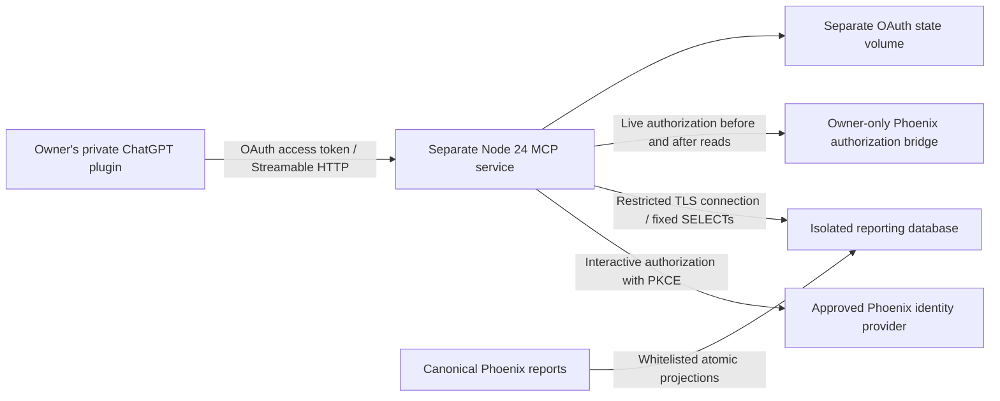

# Phoenix Workforce private MCP

Status: **implemented service and synthetic security tests; NOT production ready or connected**.

This package implements all five approved MCP tools, OAuth authorization, a restricted PostgreSQL
reader, canonical report adapters, an atomic projection publisher, and Railway container configuration.
The source proof and live authorization bridge are implemented and fixture-tested; the non-production
source rehearsal and identity-provider registration are still release gates.
See [the source proposal](proposal/SOURCE-INTERFACE.md) and [owner identity](proposal/IDENTITY.md).
There is no fallback to administrative Phoenix APIs or a service-role key.

## Architecture and baseline

The isolated branch is `codex/phoenix-chatgpt-mcp`. Its baseline is
`e96ab5b36e54d5ba6031938f826ee64582d706e9`, which matched the live health endpoint and successful
Railway deployment during the initial reconciliation. The primary checkout was left at its original
revision; its 22 pre-existing untracked files were preserved. Later production drift requires a
fresh reconciliation before any release.



The service uses the official TypeScript MCP SDK. Each HTTP request creates a stateless MCP
transport. OAuth state and token-family revocation persist in a dedicated SQLite volume. No Phoenix
results are stored there. One replica and one owner are mandatory. The public HTTPS endpoint is
authenticated; “private” means restricted access, not a private network. A Secure MCP Tunnel is an
optional later infrastructure choice and is not implemented in this package.

## Implemented tools and fields

| Tool | Inputs | Approved output |
| --- | --- | --- |
| `get_workforce_summary` | none | Active headcount and department counts |
| `get_active_employee_count` | none | Active headcount using Phoenix eligibility |
| `get_open_vacancies` | limit, opaque cursor | Position, department, line, area, open status |
| `get_organizational_structure` | limit, opaque cursor | Opaque nodeId/parentNodeId, position, occupant name, parent position, department, line, area, vacancy flag |
| `get_published_sales_summary` | YYYY-MM period, limit, opaque cursor | Published line sales, target, achievement, EGP currency and publication time |

Every tool is annotated read-only and has strict input validation. No SQL, mutation, attachment,
payroll, salary, national-ID, bank, medical, candidate or administration tool exists. Storage IDs
are not returned. Unknown fields are stripped by schemas and explicit output mapping. Free-text
labels remain untrusted data; field filtering cannot promise that a person never typed sensitive
text into a position name. Review source fields before release.

The service reuses the existing pure Phoenix permission matrix, access context, employee-scope
filter, active-directory predicate and lifecycle revocation function at build time. Administrative
clients are disabled, framework cache wrappers are removed, and a bundle check rejects surviving
administrative REST code or unreviewed external imports. No existing business function was edited.

## Authentication and database security

OAuth authorization-code flow requires S256 PKCE, exact registered callback, exact resource and
`phoenix:read` scope. The static public ChatGPT client has no shared secret; dynamic registration
is disabled. Upstream OIDC uses a separate confidential client with PKCE, state, nonce, signed ID
tokens, issuer/audience validation and interactive login. Upstream tokens are discarded.

The owner is pinned by subject, Phoenix login and exact approved role. Only Super Admin or CEO is
supported in this first version; that does not grant other holders of those roles access. Fresh
Phoenix authorization is checked at token issuance, refresh, every authenticated HTTP request,
and before and after tool reads. Disabled accounts, lifecycle revocation, session-version changes,
role changes, explicit read denials and module locks deny access. There is no authorization cache.

Access tokens last five minutes. Refresh tokens rotate once and expire absolutely after 24 hours.
Replay revokes the family. Codes last one minute; browser transactions and consent expire. SQLite
stores token hashes, principal metadata and short-lived upstream PKCE state, never business results.

The database login must be non-owner, non-superuser, NOBYPASSRLS, without memberships, schema/database
creation, TEMP, application function EXECUTE, sequence writes, business writes or unrelated SELECTs.
Each transaction verifies effective privileges and an owner/revision-pinned interface contract,
sets an identity claim locally, and runs READ ONLY. A read-only transaction is defense in depth;
the SELECT-only grants are the actual write boundary. Existing administrative credentials are
never reused. See [security review and blocked source contract](SECURITY.md).

Limits: two database connections, two concurrent MCP requests, three-second statement timeout,
half-second lock timeout, five-second idle-transaction timeout, 30 tool calls/minute, 120 HTTP
requests/minute, 50 rows/page, 2,000 directory rows, 64 KB output and 16 KB JSON requests. Over-limit
directories fail instead of silently returning a partial count. Cursors bind to owner, role,
session version, tool and period. Queries use fixed SQL with parameterized values.

Audit events contain only tool name, hashed actor, outcome and duration. They exclude arguments,
results, tokens and exception details. Gateway logs must also redact authorization headers and
OAuth query strings. Audit delivery currently relies on stdout collection; external retention and
tamper resistance need deployment configuration.

## Verification

Use Node 24 and PostgreSQL binaries (`initdb`, `pg_ctl`) on PATH. From this directory:

```sh
npm ci --ignore-scripts --no-audit --no-fund
node build.mjs --tests
node --test dist/security.test.mjs
npm audit --omit=dev --audit-level=high
```

Tests create a new loopback-only PostgreSQL cluster containing synthetic rows, then stop it. They
never load `.env.local`, use a supplied database URL, or contact Phoenix. Temporary fixture logs
remain in the operating system's temp directory. Do not execute as a database superuser on Linux:
`initdb` is intended for an ordinary OS user. The test role uses trust authentication ONLY inside
that temporary loopback fixture, never in deployment.

The dedicated CI workflow runs a cold integration typecheck, protocol/security tests and dependency
audit. Phoenix's existing CI remains unchanged and supplies regression checks. Local fixture tests
do not prove production RLS, source parity, OIDC interoperability or Railway operation. Those remain
release gates. See [verification record](VERIFICATION.md).

## Release and operation

[RUNBOOK.md](RUNBOOK.md) contains the Railway requirements, environment-variable names, exact ChatGPT
connection procedure, estimated costs, and shutdown/rollback steps. No deployment, production
permission change, database migration, OAuth registration, environment update or live ChatGPT
connection has been performed. No merge is authorized.

## Exact file inventory

Created in `infra/phoenix-mcp/`:

- `.gitignore`, `package.json`, `package-lock.json`, `tsconfig.json`, `build.mjs`
- `Dockerfile`, `Dockerfile.dockerignore` (its Railway settings are in `RUNBOOK.md`; the `railway.toml` was retired on 2026-10-23)
- `src/config.mts`, `src/contracts.mts`, `src/database.mts`, `src/main.mts`
- `src/oauth.mts`, `src/phoenix-policy.mjs`, `src/phoenix-policy.d.mts`, `src/policy.mts`
- `src/server.mts`, `src/state.mts`, `src/tools.mts`
- `src/phoenix-source.mjs`/`.d.mts`, `src/source-adapters.mts`, `src/source-collect.mts`, `src/publish-cycle.mts`, `src/publisher.mts`
- `source/phoenix-bindings.mjs`, `source/run-publisher.mjs` (source side only, never bundled into the reader)
- `proposal/source-watermark.sql` (review only)
- `tests/fixtures.mts`, `tests/postgres-fixture.mts`, `tests/security.test.mts`, `tests/integration.test.mts`, `tests/pipeline.test.mts`, `tests/source-host.mts`, `tests/proofs.mts`
- `README.md`, `SECURITY.md`, `RUNBOOK.md`, `VERIFICATION.md`

Created outside this package: `.github/workflows/phoenix-mcp.yml` (isolated checks, no deployment).

Modified: root `tsconfig.json` excludes this independent service from the Next.js project; the
service has its own typecheck. Existing Phoenix behaviour is unchanged: new opt-in code lives in `src/lib/mcp-source/` and
`app/api/mcp-source/authorize` (disabled unless `PHOENIX_MCP_SOURCE_ENABLED=true`), with one-line touches to
`proxy.ts` (CSRF shared-secret exemption), `src/lib/security/access-registry.ts` and one added export in
`src/lib/auth/permissions.ts`. Generated
`dist/` and package-local `node_modules/` are ignored and not committed.
